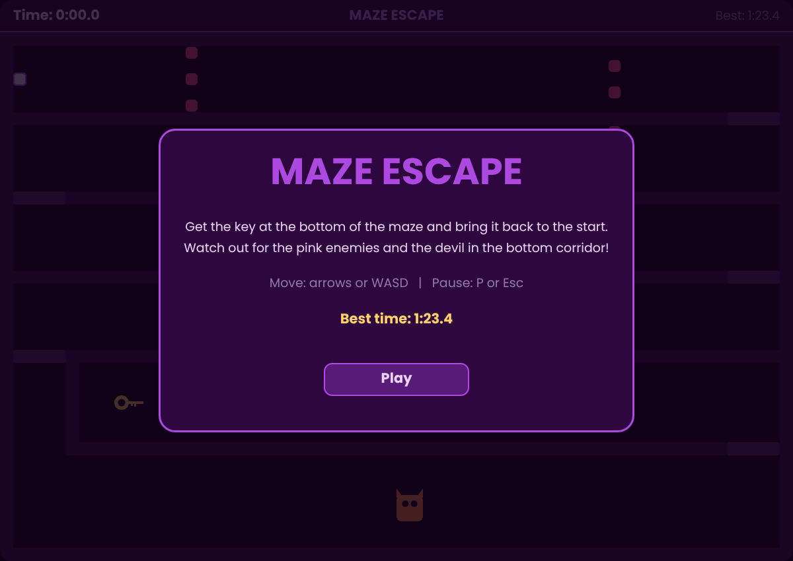
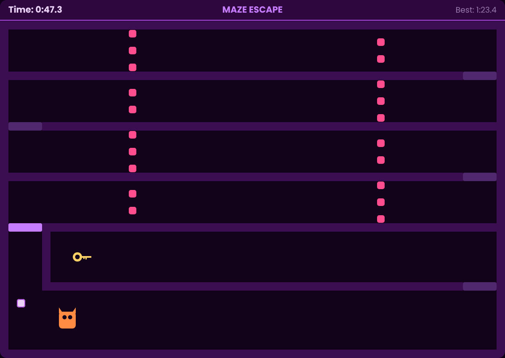
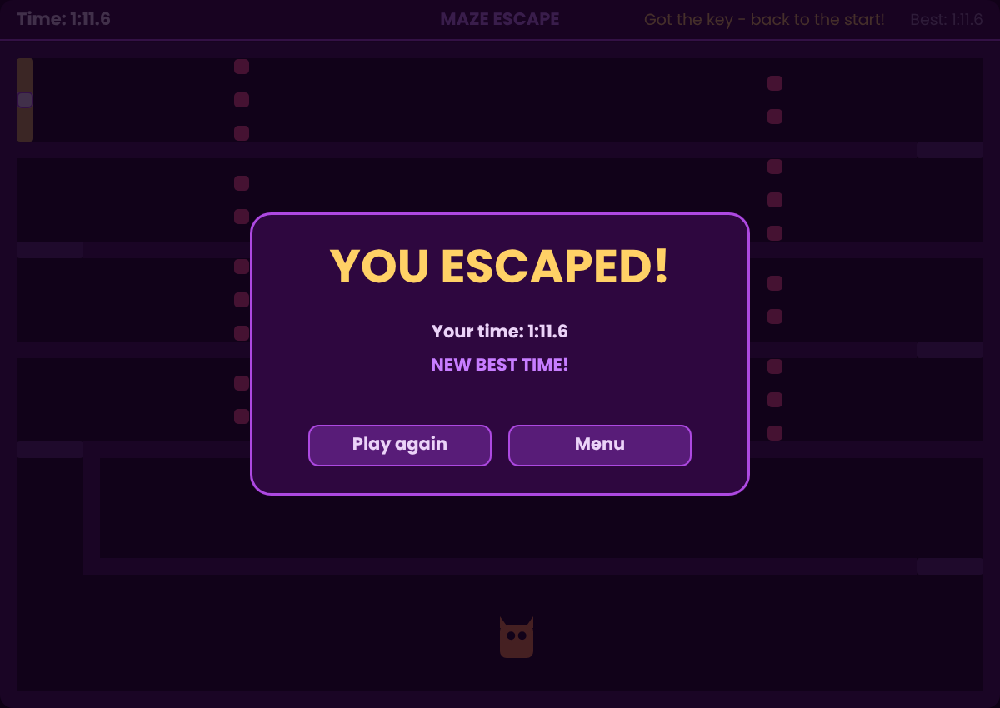

# 🗝️ Maze Escape

A maze game where you have to get a key from the bottom of the maze and bring it back to the start, past moving enemies and a devil that chases you. The goal is to escape as fast as you can.

I first wrote it in **Python** with **pygame**, then rewrote it in **JavaScript** (HTML Canvas) so it can be played instantly in the browser. Both versions have the same logic and look, and all the graphics are drawn in code, with no image files.

**▶ Play it here:** https://20kita.github.io/maze-game/

<p align="center">
  
  
  
</p>

---

## Table of contents

1. [Features](#features)
2. [Controls](#controls)
3. [Two versions](#two-versions)
4. [Project structure](#project-structure)
5. [Running the game](#running-the-game)
6. [How it works](#how-it-works)
7. [How the project changed](#how-the-project-changed)
8. [What I learned](#what-i-learned)

---

## Features

- **Start menu**, **pause** and a **win screen** with clickable buttons
- **Timer** shown as minutes and seconds (`1:15.3`)
- **Best time saved**, kept after closing the game, with a "New best time!" message
- **20 enemies** moving left and right through the corridors
- **A devil boss** that chases you in the bottom corridor and goes back home when you leave
- **Checkpoints**: after you die, you come back at the last checkpoint you touched (it glows brighter)
- **A key and a gate**: the gate to escape only appears after you pick up the key
- **Dark theme** in the same colors as my portfolio
- **Graphics drawn in code**: a key with a ring and teeth, a devil with horns and eyes, a pulsing gate

Extra in the browser version:
- **Phone support**: drag your finger to move (like a joystick), tap the top bar to pause
- **Auto-pause** when you switch tabs or click outside the game
- **Scales to any screen size** and stays sharp on high-resolution screens

## Controls

| Action | Keyboard | Phone |
|---|---|---|
| Move | Arrows or WASD | Drag your finger |
| Pause / resume | P or Esc | Tap the top bar |
| Start / play again | Enter or Space, or click the button | Tap the button |
| Back to menu | M (paused), Esc (win screen), or click the button | Tap the button |

---

## Two versions

| | Python version | JavaScript version |
|---|---|---|
| File | `main.py` | `index.html`, `style.css`, `game.js` |
| Language | Python 3 | HTML, CSS, JavaScript |
| Library | pygame | none (HTML Canvas) |
| Runs | on a computer | in any browser, also on phones |
| Best time saved in | `best_time.json` | the browser's `localStorage` |

## Project structure

```
maze-game/
├── index.html       # the web page: a <canvas> for the game, loads style.css and game.js
├── style.css        # centers the game and scales it to the screen
├── game.js          # the JavaScript version of the game
├── main.py          # the Python version of the game
└── screenshots/     # images used in this README
```

Both `game.js` and `main.py` are built the same way:

| Part | What it does |
|---|---|
| Settings and the level | Board size, speeds, walls, checkpoints and enemies in one place |
| Colors | The whole dark theme in one place |
| Load / save best time | Read and write the best time |
| Helpers | `overlaps()`, `step_towards()`, `format_time()` and a few more |
| `Button` class | A reusable clickable button with a hover effect |
| `Game` → `update()` | Moves everything, handles the key, checkpoints, dying and winning |
| `Game` → input handling | Keyboard, mouse (and touch in JS) for each state |
| `Game` → `draw...()` methods | Drawing the board, the key, the devil, the top bar and the screens |
| `Game` → main loop | Runs the game frame by frame |

---

## Running the game

### JavaScript version
Just open `index.html` in a browser; nothing needs to be installed. It's also live at https://20kita.github.io/maze-game/.

### Python version
1. Install pygame:
   ```
   pip install pygame
   ```
2. Run the game:
   ```
   python main.py
   ```

---

## How it works

### Squares, not pixels
The board is a 60 × 40 grid. All the game logic uses positions in squares, like `(9, 27.5)`. Things can stand between squares, because the player moves half a square at a time and the enemies a quarter. Positions are changed into pixels only when drawing.

Every object is a box: `(x, y, width, height)`. One small function checks if two boxes overlap, and it's used for everything: walls, enemies, the devil, the key, the gate and the checkpoints.

```python
def overlaps(a, b):
    return (a[0] < b[0] + b[2] and a[0] + a[2] > b[0] and
            a[1] < b[1] + b[3] and a[1] + a[3] > b[1])
```

### Walls
Before the player moves, the game checks where the player *would* be after the move. If that box overlaps a wall, the move doesn't happen. Left/right and up/down are checked separately, so you can slide along a wall when moving diagonally.

### Enemies
There are two groups of enemies. One starts on the left and the other on the right, and each group moves together. When a group reaches the edge of its path, its direction is multiplied by `-1`, so it turns around.

### The devil
The devil only hunts in the bottom corridor. When you're there, it moves towards you a small step every frame (`step_towards()`), aiming its middle at your middle. When you leave, it goes back home. Its position is "clamped" to the corridor, so it can never go through a wall. It's slower than you, so you can always run away, but you have to pass it twice: on the way to the key and on the way back.

### Game states
The game is always in one of four states: `menu`, `playing`, `paused` or `won`. The state decides what each key does and which screen is drawn. The enemies keep moving in every state, so the menu has a moving background.

### The timer
The time only goes up in the `playing` state, so pausing stops the clock. It's shown as `minutes:seconds.tenths`. The number is rounded *before* it's split into minutes and seconds, so `59.96` becomes `1:00.0` and not `0:60.0`.

### The same speed on every screen
The game logic runs 30 times per second. In Python, `clock.tick(30)` handles that. In JavaScript, `requestAnimationFrame()` runs as often as the screen refreshes (60, 120 or 144 times per second), so the time between frames is collected and turned into game steps of 1/30 second. This way, the game runs at the same speed on every screen.

### Best time
- **Python:** saved to `best_time.json` using the `json` module.
- **JavaScript:** websites can't write files on the visitor's computer, so the best time is saved in the browser's `localStorage`.

Both use `try` / `except` (Python) or `try` / `catch` (JavaScript), so if saving isn't possible, the game still works.

### Phone controls
When you touch the board, the game remembers where your finger started. When you drag, the direction from that point decides where the player goes, like a joystick. A small "dead zone" in the middle means a shaky finger doesn't move you by accident. A ring and a dot show where the joystick is.

---

## How the project changed

The first version was one long loop with variables like `Pozwolenie_1` to `Pozwolenie_8`, a list of 20 enemies written out one by one, and no way to win. I rebuilt it step by step:

1. **Cleaning up**: one `can_move()` function instead of eight variables, enemies built from a list of rows, checkpoints that store their own respawn point
2. **Winning**: the gate became the finish, with a timer
3. **The devil**: an unused piece of code became a boss that chases you
4. **Menu and best time**: game states and a saved best time
5. **Looks**: a dark theme matching my portfolio, a top bar, WASD controls
6. **JavaScript version**: so it can be played in the browser and on phones

## What I learned

- Building a game around a **game loop** and **states**
- **Refactoring** messy code into small functions without changing how the game plays
- Using **classes** to organize code (`Game`) and to make reusable parts (`Button`)
- Keeping the game logic (squares) separate from the drawing (pixels)
- Simple **collision detection** with boxes, and a basic **chasing AI**
- Making a game run at the **same speed on every screen** (a fixed time step)
- Saving data with **JSON** and **localStorage**, and handling errors
- **Rewriting a project in another language**, and adding **touch controls**
- Publishing a project on **GitHub Pages**

---

Made by **Natalia Cieszyńska** · [Portfolio](https://20kita.github.io/kita-portfolio/) · [GitHub](https://github.com/20kita)